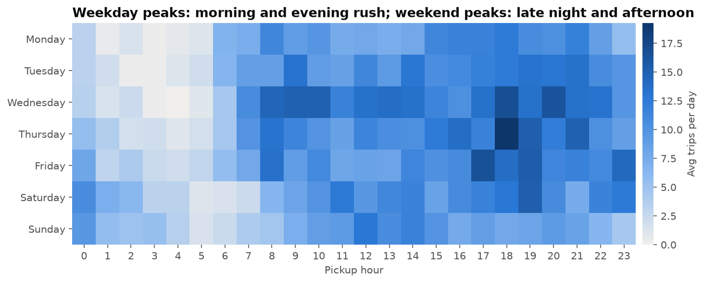
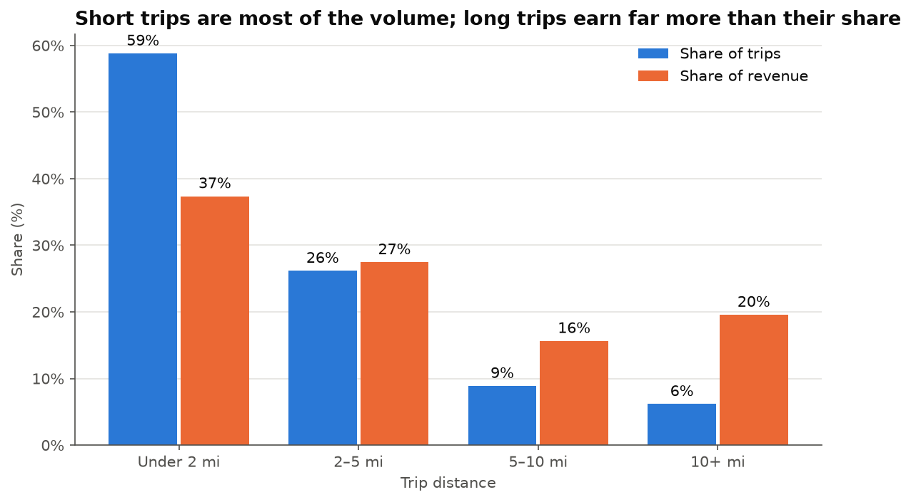
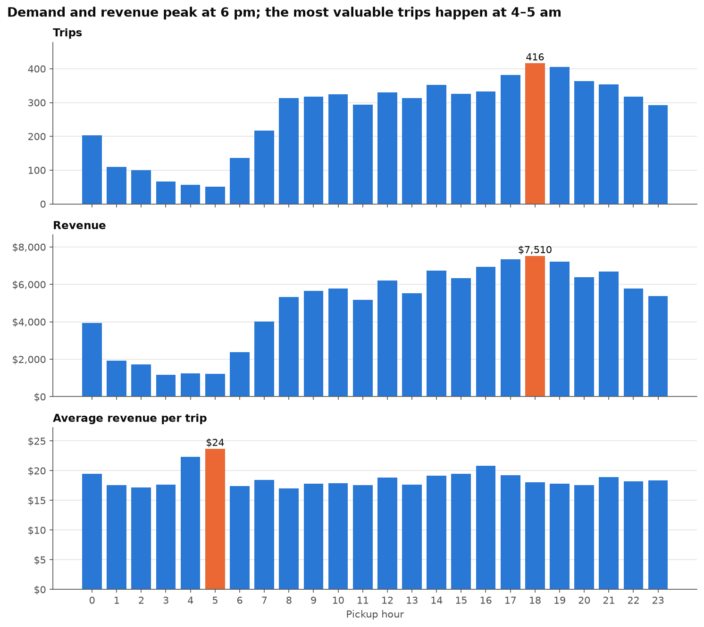
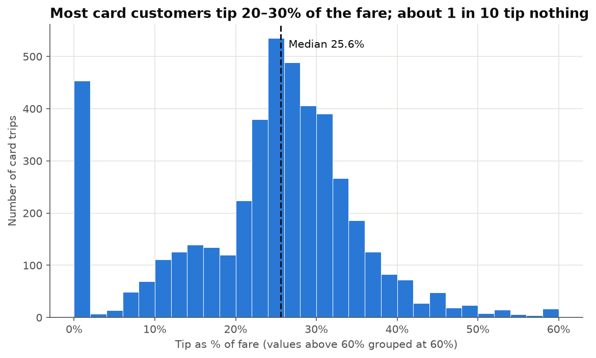
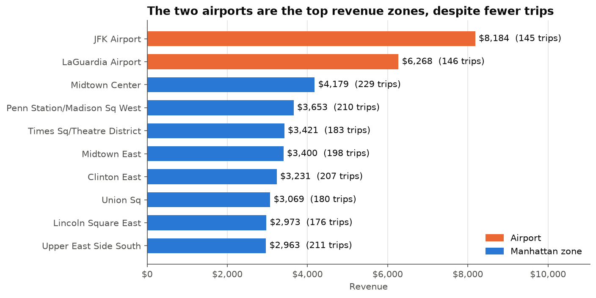

# NYC Taxi Analytics

An end-to-end data analysis of **6,433 New York City taxi trips from March 2019**: exploring the data, cleaning it, running a business-focused EDA, and preparing a dataset for a Power BI dashboard.

The analysis answers five business questions:

1. **Revenue:** where does the money come from?
2. **Demand:** when do customers need taxis?
3. **Payments:** how do customers pay and tip?
4. **Geography:** where do valuable trips start and end?
5. **Efficiency:** how efficiently are trips completed?



---

## Key findings

| Area | Finding |
|---|---|
| Revenue | **$117.5k** total revenue; fares make up 70%. Mean trip $18.45, median $14.16. |
| Revenue | Trips under 2 mi are **59% of trips but only 37% of revenue**. Trips of 10+ mi are 6% of trips and 20% of revenue. |
| Pricing | Fare ≈ **$4.45 + $2.81 per mile** (R² = 0.92). JFK flat fares form a visible $52 band. |
| Taxi type | Yellow cabs earn **86% of revenue**. Green cab trips are paid in cash more often (40% vs 26%). |
| Demand | Peak at **6 pm** (416 trips). Wednesday is busiest (239 trips/day); Sunday and Monday are quietest (~175). |
| Payments | Card trips are 71% of trips and worth **35% more** than cash trips ($19.93 vs $14.74). |
| Tipping | Median card tip is **25.6%**; 9.7% of card trips leave no tip. Tip dollars rise with distance while tip % falls. |
| Geography | Manhattan has 82% of pickups. **JFK and LaGuardia** are the top revenue zones. |
| Efficiency | The average trip takes 14.5 min over 3.05 mi. Traffic slows to ~11 mph from 8 am to 6 pm, and early-morning trips earn the most per minute. |

> Day-of-week numbers use **trips per calendar day**: March 2019 has five Fridays, Saturdays and Sundays but only four of every other weekday.

<p>
  
  
</p>
<p>
  
  
</p>

---

## Project structure

```
taxi_analytics/
├── data/
│   ├── raw/taxis.csv                 # original data (6,433 trips × 14 columns)
│   └── processed/taxis_clean.csv     # cleaned data (6,371 trips × 22 columns)
├── notebooks/
│   ├── 01_initial_exploration.ipynb  # shape, types, missing values, suspicious values
│   ├── 02_data_cleaning.ipynb        # cleaning rules, new features, validation checks
│   ├── 03_eda.ipynb                  # the five business questions, with charts
│   └── 04_insights_and_dashboard_prep.ipynb  # insights table + Power BI dataset export
└── dashboard/figures/                # the 19 charts produced by notebook 03
```

## Data

The dataset is the `taxis` sample from [seaborn-data](https://github.com/mwaskom/seaborn-data), a subset of the NYC TLC trip records for March 2019. Each row is one trip with:
- pickup and dropoff times and zones
- passengers and distance
- fare, tip, tolls and total
- taxi color (yellow/green) and payment type

**Cleaning** ([02_data_cleaning.ipynb](notebooks/02_data_cleaning.ipynb)):
- removed 62 impossible trips (zero or negative duration, zero distance, or speeds above 60 mph)
- filled missing categories with "Unknown"
- set the passenger count to missing where it was 0
- flagged fare outliers with the IQR rule
- added features: duration, speed, hour, weekday, weekend flag and tip %

## How to run

Requires Python 3.10+.

```bash
git clone https://github.com/SeyhakHorn/taxi_analytics.git
cd taxi_analytics
pip install pandas numpy matplotlib jupyter
jupyter notebook notebooks/
```

Run the notebooks in order (01 → 04):
- Notebook 02 writes `data/processed/taxis_clean.csv`.
- Notebook 03 saves its charts to `dashboard/figures/`.
- Notebook 04 exports `data/powerbi/taxi_trips.csv` (36 columns, ready for Power BI).

Tested with Python 3.11, pandas 3.1, NumPy 2.4 and matplotlib 3.11.

## Power BI dashboard

Notebook 04 prepares a dashboard-ready dataset with:
- helper columns for sorting and grouping: time periods, distance bands and day order
- airport and flat-fare flags
- revenue per mile and per minute
- a data-quality flag

The Power BI files (the report, DAX measures and theme) are kept locally and are not part of this repository.

## Tools

Python · pandas · NumPy · matplotlib · Jupyter · Power BI
